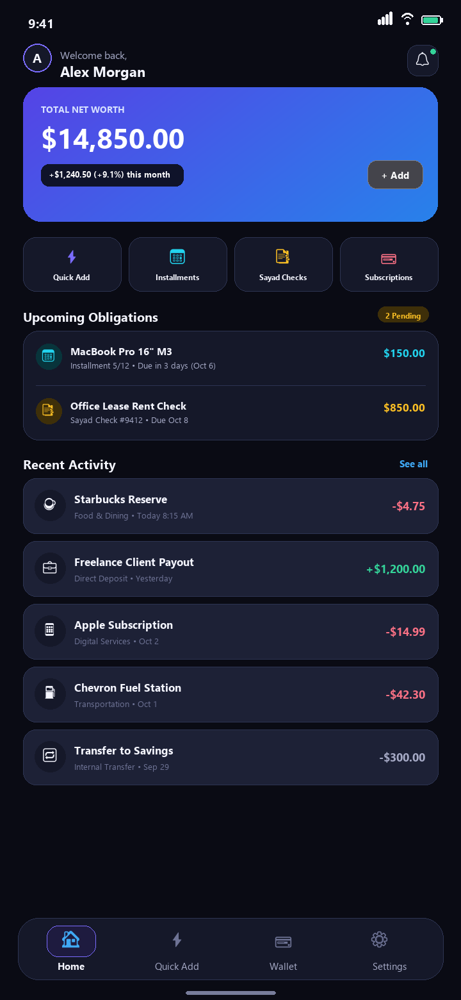
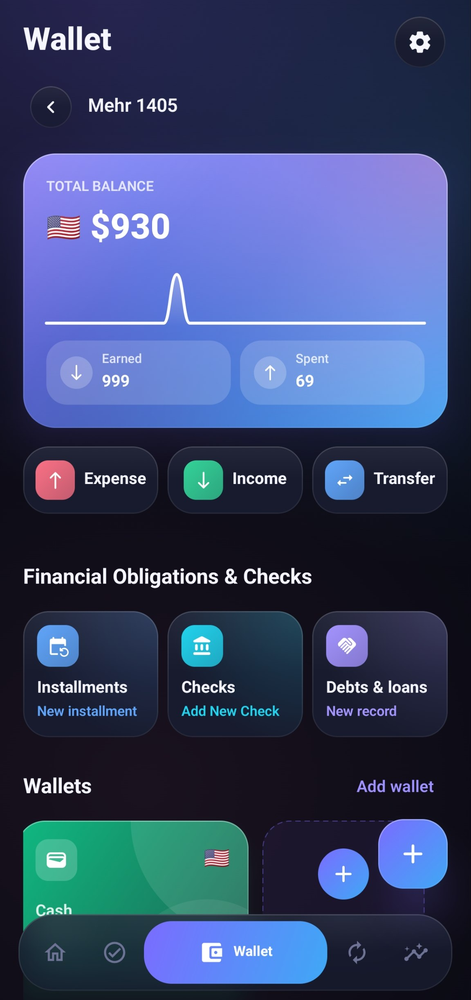
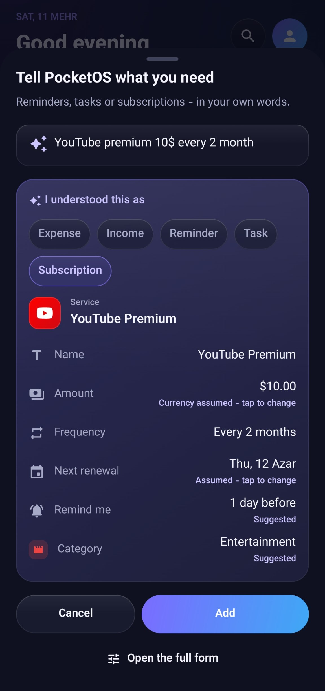
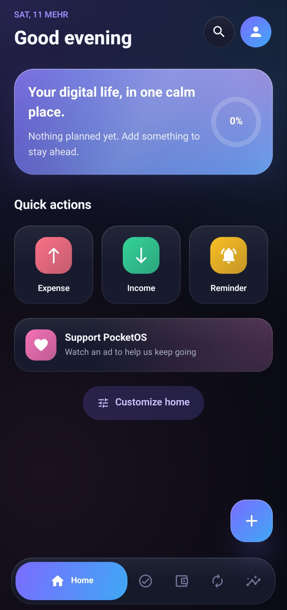
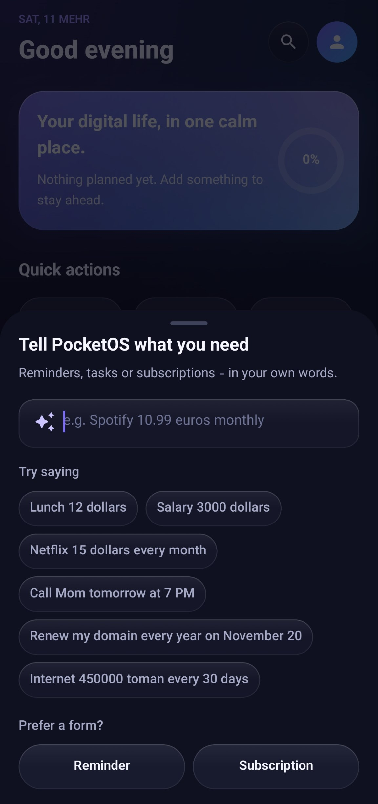
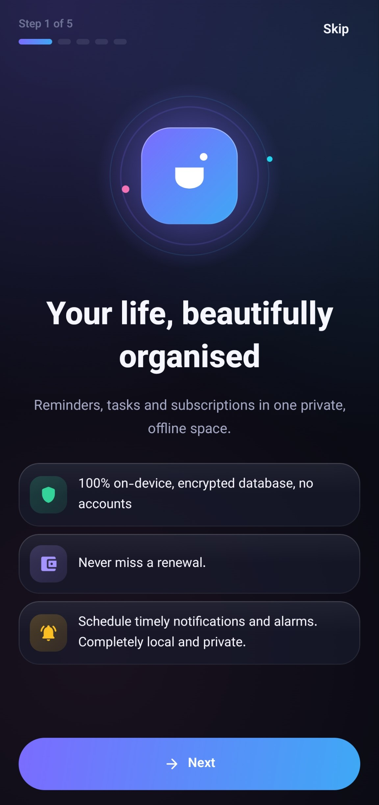

# PocketOS

> [!IMPORTANT]
> **Source-Available Software Notice**  
> The source code of PocketOS is made publicly available strictly for transparency, open security auditing, and personal, non-commercial use. Unauthorized redistribution, commercialization, rebranding, or publishing compiled binaries (`.apk` / `.aab`) to any application marketplace (including Google Play, Myket, Cafe Bazaar, etc.) is strictly prohibited and legally enforced under the [LICENSE](LICENSE).

<div align="center">

**Your private, offline personal command center for daily finances, installments, reminders, and subscriptions.**

*100% Local-First. Zero Cloud Tracking. Hardware-Backed Encryption.*

[](https://developer.android.com)
[](LICENSE)
[](SECURITY.md)
[](SECURITY.md)
[](https://www.virustotal.com/gui/file/9d9bc3b53e5ede7282fa0f7468994b337e4dedd49ed47ec9402a8fa65406d37c/detection)
[](https://github.com/pooriyayt/PocketOS/releases)
[](https://pouriyaparniyan.ir)

<br/>

<p align="center">
  <a href="#فارسی" style="text-decoration:none;">
    
  </a>
</p>

### 📥 Download

<p align="center">
  <a href="https://myket.ir/app/app.pocketos" style="text-decoration:none;"></a><a href="https://github.com/pooriyayt/PocketOS/releases/tag/v1.5.1" style="text-decoration:none;"></a>
</p>

<p align="center">
  <a href="https://www.virustotal.com/gui/file/9d9bc3b53e5ede7282fa0f7468994b337e4dedd49ed47ec9402a8fa65406d37c/detection">
    
  </a>
</p>

---

<p align="center">
  
  &nbsp;
  
  &nbsp;
  
</p>
<p align="center">
  
  &nbsp;
  
  &nbsp;
  
</p>

[English](#english) • [فارسی](#فارسی)

</div>

---

<a name="english"></a>
## English

PocketOS is a modern, privacy-first, local-first Android application designed to manage your personal finances, installment loans, debts & receivables, subscriptions, and daily tasks in one calm, unified dashboard.

There are **no accounts**, **no cloud sync servers**, and **no third-party tracking**. All data is stored directly on your phone in an **AES-256 encrypted database** managed by the **Android Keystore**.

### 🌟 Key Highlights

#### 🧠 Smart Quick Add (Natural Language Accounting)
- **Conversational Entry**: Type or speak everyday phrases like `"150k dinner at sushi place"`, `"taxi 35"`, `"salary 5000"`, or `"loan installment 250"`.
- **Instant Keyword & Amount Detection**: Automatically recognizes Western, Persian, and Arabic numbers, detects colloquial Iranian Toman scaling (`۱۵۰ تومن` → `150,000 تومان`), categorizes expenses, and infers payment methods.
- **Preview & Edit**: One-tap confirmation sheet lets you adjust categories, accounts, or dates before saving.

#### 🌍 Global Currency Support
- **160+ Currencies**: Full ISO 4217 world currency support with country flags and instant search.
- **Iranian Toman & Rial**: Native support for Toman (`IRT / تومان`) and Rial (`IRR / ریال`) with proper digit formatting and locale-aware groupings.
- **Multi-Wallet Balance**: Track cash, bank accounts, and cards in your preferred base currency.

#### 📆 Installments & Loan Management
- **Automated Installment Schedules**: Set up multi-month loans once with total installments, monthly due dates, and remaining counts.
- **Multi-Calendar Engine**: Full native support for **Solar Hijri / Jalali (شمسی)**, **Islamic / Lunar Hijri (قمری)**, and **Gregorian (میلادی)** calendars with a custom date picker.
- **Proactive Reminders**: Local scheduled notifications alert you 3 days before any installment is due and on the exact due date.
- **Auto-Rollforward**: Automatically advances to the next month upon payment confirmation.

#### 📑 Check Management & Clearance Tracking
- **Issued & Received Checks**: Complete lifecycle tracking for Sayad and commercial bank checks (Issued / صادره and Received / دریافتی).
- **Due-Date Proactive Alarms**: Receive automatic reminders 2-3 days before check maturity so you can ensure sufficient account balance and prevent returned checks.
- **Interactive Clearance Prompt**: On or after the due date, PocketOS interactively asks *"Has this check cleared?"* with one-tap status updates (Pending, Cleared, Bounced).
- **Automatic Wallet Sync**: Marking an issued check as cleared automatically logs an expense and debits the designated bank account balance.

#### 👥 Smart Bill & Group Trip Splitter (محاسبه دنگ)
- **Equitable Group Settlement**: Log shared group expenses during trips, parties, and dinners with customizable payer and participant distribution.
- **Optimized Debt Solver**: Uses an algorithmic greedy simplification model to eliminate circular debts and settle all balances with the minimum number of transactions.
- **Direct Debts Integration**: Export final settlement debts directly into your "Debts & Receivables" tracker with a single tap.
- **Offline Session Persistence**: Group members and expense data persist safely in local storage across sessions.

#### 📈 30-Day Predictive Cash Flow & Shortfall Alert
- **Automated Balance Forecast**: Projects your net balance across bank accounts over the next 30 days based on scheduled checks, loan installments, and recurring subscriptions.
- **Deficit Warning**: Proactively warns you when scheduled commitments exceed incoming cash flow to prevent account overdrafts.

#### ⚡ Android Quick Settings Tile
- **Instant System Shade Access**: Pull down the notification shade and tap the PocketOS tile to instantly launch the natural language Quick Add sheet from anywhere in Android.

#### 🤝 Debts & Receivables Tracker
- **"I Owe" & "Owed to Me"**: Track personal loans and borrowings with individuals or organizations.
- **Partial Repayments**: Record progressive partial payments, maintain repayment logs, and update balances dynamically.
- **Wallet Linking**: Optionally deduct or credit payments directly from your selected wallet account.

#### 💳 Subscription & Renewal Alerts
- **Offline Catalog**: Built-in recognition for hundreds of popular digital services (Netflix, Spotify, GitHub, YouTube, Telegram, etc.).
- **Smart Icons**: Choose bundled logos, vector icons, custom monograms, or website favicons.
- **Pre-Billing Notifications**: Timely alerts before billing cycles renew or free trials expire.

#### 🛡️ Ironclad Privacy & Security
- **100% Offline**: Works without network connectivity.
- **SQLCipher AES-256**: The local Room SQLite database is encrypted using SQLCipher. Master keys are securely generated and stored in the hardware-backed **Android Keystore**.
- **Encrypted Backups**: Export and import complete backups protected by **AES-256-GCM** with **PBKDF2** key derivation (100,000 iterations).

#### 🌿 Luxury Emerald UI
- **Refined Aesthetics**: Deep dark (`#090E0B`) and crisp light (`#F5F9F7`) palettes with fluid animations.
- **Liquid Morphing Navigation**: Dynamic indicator drops, bouncy icons, and haptic feedback.
- **Glance AppWidgets**: Home screen widgets for immediate glanceable overview of pending tasks and balances.

---

<a name="فارسی"></a>
## فارسی

پاکت او اس (**PocketOS**) یک اپلیکیشن مدرن، کاملاً آفلاین و با تمرکز بر حفظ حداکثری حریم خصوصی برای اندروید است که به شما امکان می‌دهد تراکنش‌های مالی، اقساط وام‌ها، طلب و بدهی‌ها، یادآورها و اشتراک‌های خود را در یک محیط زیبا، یکپارچه و امن مدیریت کنید.

در پاکت او اس **هیچ نیازی به ساخت حساب کاربری، اتصال به سرورهای ابری، یا ردیابی فعالیت‌ها نیست**. تمامی اطلاعات شما به صورت محلی و با رمزنگاری پیشرفته **AES-256** تحت محافظت سخت‌افزاری **Android Keystore** فقط و فقط روی حافظه دستگاه خودتان نگهداری می‌شود.

### 🌟 ویژگی‌های برجسته

#### 🧠 ثبت سریع و هوشمند (Smart Quick Add)
- **تشخیص زبان عامیانه و متن آزاد**: متن‌هایی نظیر «۱۵۰ تومن ساندویچ»، «اسنپ ۳۵ تومن»، «حقوق ۵ میلیون» یا «قسط وام» را بنویسید تا برنامه به طور خودکار نوع تراکنش، مبلغ، و دسته‌بندی مناسب را شناسایی کند.
- **تبدیل هوشمند تومان و هزار تومان**: اعداد عامیانه فارسی نظیر «۱۵۰ تومن» به طور هوشمند به ۱۵۰٬۰۰۰ تومان مقیاس‌بندی می‌شوند.
- **پیش‌نمایش قبل از ذخیره**: امکان تغییر دسته‌بندی، کیف پول یا تاریخ با یک لمس قبل از ثبت نهایی.

#### 🌍 پشتیبانی از تمامی ارزهای جهان
- **بیش از ۱۶۰ ارز بین‌المللی**: همراه با پرچم کشورها و جستجوی لحظه‌ای بر اساس کد و نام ارز.
- **پشتیبانی کامل از تومان و ریال**: امکان انتخاب «تومان (IRT)» یا «ریال (IRR)» با فرمت‌بندی استاندارد ارقام فارسی و جداسازی سه رقمی.
- **مدیریت چند کیف پول**: حساب‌های بانکی، کارت‌ها و موجودی نقدی را مجزا ثبت کنید.

#### 📆 مدیریت پیشرفته اقساط و وام‌ها
- **ثبت اقساط ماهیانه**: یک‌بار وام را با تعداد کل اقساط و مبلغ هر قسط ثبت کنید تا بدون نیاز به ثبت مجدد ماهانه، اقساط باقی‌مانده و سررسید به طور خودکار محاسبه شود.
- **موتور تقویم سه‌گانه**: پشتیبانی کامل از **تقویم هجری شمسی (جلالی)**، **تقویم هجری قمری** و **تقویم میلادی (Gregorian)** با دیت‌پیکر اختصاصی.
- **یادآوری هوشمند سررسید**: ارسال نوتیفیکیشن محلی ۳ روز پیش از موعد قسط و همچنین در روز سررسید.
- **انتقال خودکار به قسط بعد**: با ثبت هر پرداخت، وضعیت وام به‌روز شده و سررسید قسط بعدی محاسبه می‌گردد.

#### 📑 مدیریت و پیگیری چک‌های بانکی و صیادی
- **چک‌های صادره و دریافتی**: ثبت چک‌های پرداختی و دریافتی با شناسه صیادی ۱۶ رقمی، نام بانک، موعد سررسید و نام شخص/شرکت طرف حساب.
- **یادآوری هوشمند ۲ الی ۳ روز قبل از سررسید**: آلارم و نوتیفیکیشن‌های پیشگیرانه جهت تأمین موجودی حساب و جلوگیری از برگشت خوردن چک.
- **استعلام خودکار وضعیت پاس شدن**: در روز موعد یا پس از آن، برنامه به صورت تعاملی می‌پرسد «آیا این چک پاس شد؟» تا کاربر با یک کلیک وضعیت را به «پاس شد»، «برگشت خورد» یا «در انتظار» تغییر دهد.
- **اتصال هوشمند به کیف پول**: در صورت پاس شدن چک صادره، مبلغ آن به طور خودکار در قالب هزینه ثبت شده و از حساب بانکی متصل کسر می‌گردد.

#### 👥 دستیار هوشمند دنگ و سفر (Smart Bill Splitter)
- **تقسیم عادلانه و هوشمند مخارج**: ثبت کلیه هزینه‌های مشترک در سفرها، دورهمی‌ها و خریدهای گروهی با تعیین دقیق پرداخت‌کننده و افراد سهیم.
- **الگوریتم بهینه‌سازی تسویه**: محاسبه کمترین تعداد جابجایی پول میان افراد جهت بستن کامل بدهی‌ها بدون پیچیدگی و سردرگمی.
- **انتقال مستقیم به دفتر طلب و بدهی**: ثبت مستقیم تسویه‌های نهایی در بخش «طلب و بدهی» برنامه تنها با یک لمس.
- **ذخیره‌سازی پایدار و آفلاین**: ذخیره خودکار افراد و خرج‌ها روی گوشی بدون پاک شدن هنگام خروج از صفحه.

#### 📈 پیش‌بینی ۳۰ روزه جریان نقدینگی و هشدار کسری حساب
- **شبیه‌سازی مانده حساب‌های بانکی**: تحلیل هوشمند موجودی کیف پول‌ها در ۳۰ روز آینده با در نظر گرفتن چک‌های سررسید نزدیک، اقساط وام‌ها و تمدید اشتراک‌ها.
- **هشدار زودهنگام کسری موجودی**: آگاه‌سازی شما در صورتی که مجموع تعهدات آتی از دریافتی‌ها بیشتر باشد تا مانع از برگشت خوردن چک یا کسری حساب شوید.

#### ⚡ کاشی دسترسی سریع اندروید (Quick Settings Tile)
- **دسترسی سریع از نوار اعلانات**: افزودن کاشی PocketOS به بخش تنظیمات سریع بالای گوشی جهت ثبت فوری تراکنش، یادآور یا تسویه از هر کجای سیستم‌عامل.

#### 🤝 مدیریت بدهی‌ها و طلب‌ها
- **بخش اختصاصی «بدهکارم / بستانکارم»**: پیگیری مبالغی که از دیگران طلب دارید یا به آن‌ها مقروض هستید.
- **ثبت تسویه و بازپرداخت‌های جزئی**: ثبت چند مرحله‌ای بازپرداخت، مشاهده مانده نهایی و لاگ تاریخچه پرداخت‌ها.
- **اتصال اختیاری به کیف پول**: امکان کسر یا واریز خودکار مبلغ پرداخت به کیف پول انتخابی.

#### 💳 پیگیری اشتراک‌ها و هزینه‌های دوره‌ای
- **کاتالوگ سرویس‌های محبوب**: شناسایی خودکار سرویس‌ها (اسپاتیفای، یوتیوب، گیت‌هاب، نتفلیکس، تلگرام و...).
- **هشدار قبل از اتمام تمدید**: نوتیفیکیشن‌های پیش از تمدید مجدد یا پایان دوره آزمایشی رایگان (Free Trial).

#### 🛡️ امنیت و حریم خصوصی مطلق
- **کاملاً آفلاین**: برنامه بدون نیاز به اینترنت عمل می‌کند.
- **گزارش رسمی و پاک VirusTotal**: تمامی فایل‌های خروجی و نصبی پاکت او اس توسط ده‌ها آنتی‌ویروس معتبر اسکن شده و وضعیت کاملاً ایمن و پاک دارند ([مشاهده گزارش اسکن VirusTotal](https://www.virustotal.com/gui/file/9d9bc3b53e5ede7282fa0f7468994b337e4dedd49ed47ec9402a8fa65406d37c/detection)).
- **رمزنگاری سرتاسری پایگاه داده**: استفاده از پایگاه داده امن SQLCipher با کلید مشتق‌شده از ماژول امنیتی دستگاه (Android Keystore).
- **پشتیبان‌گیری رمزنگاری‌شده**: قابلیت تهیه فایل بکاپ با رمز عبور دلخواه به صورت فایل رمزگذاری‌شده با الگوریتم **AES-256-GCM** و **PBKDF2** (۱۰۰ هزار دور).

---

## Security & Trust

> [!TIP]
> **100% Clean & Verified Binary**: Every official PocketOS release is thoroughly inspected and verified against dozens of antivirus engines.
> 
> 🛡️ **[View Full VirusTotal Analysis Report (0 Detections)](https://www.virustotal.com/gui/file/9d9bc3b53e5ede7282fa0f7468994b337e4dedd49ed47ec9402a8fa65406d37c/detection)**

- **Zero Package Installer Permissions**: PocketOS requests NO package installation permissions (`REQUEST_INSTALL_PACKAGES`) across all builds. Updates are downloaded transparently through the user's browser to the Downloads folder, completely eliminating dropper alerts and Google Play Protect false-positives.
- **Hardware-Protected Keys**: No plain-text passwords or secret keys exist in the application files.
- **Minimal Permissions**: Only requests strictly needed system capabilities (`POST_NOTIFICATIONS`, `SCHEDULE_EXACT_ALARM`, `USE_BIOMETRIC`).
- **Reproducible Signed Binaries**: Built with ProGuard/R8 dead-code stripping, resource shrinking, and full optimization.

---

## Building from Source

### Prerequisites
- **JDK 17** or **JDK 21**
- **Android SDK** (API 26 minSdk, API 36 targetSdk, API 37 compileSdk)
- **Gradle 9.x** (wrapper included)

### Build Commands

```bash
# Clone the repository
git clone https://github.com/pooriyayt/PocketOS.git
cd PocketOS

# Build debug APK
./gradlew assembleDebug

# Build unified release APK (Self-Updating & Store Ready)
./gradlew assembleRelease
```

The compiled APK will be located in:
- `app/build/outputs/apk/release/app-release.apk`

---

## Architecture & Tech Stack

- **UI Framework**: Modern Jetpack Compose, Material 3, Navigation Compose, Compose Animation.
- **Architecture**: MVI / MVVM with Kotlin Coroutines & StateFlow.
- **Database & Persistence**: Room + SQLCipher (Hardware Keystore protected).
- **Time & Calendar**: Java Time (`java.time.*`), Chrono classes for Hijri and Jalali calendar conversion.
- **Widgets**: Jetpack Glance Compose for Android Home Screen widgets.
- **Dependency Injection**: Manual scoped container architecture (`AppContainer`) ensuring fast cold starts and zero reflection overhead.

---

## License

```text
PocketOS Source-Available License (POSAL) v1.0
Copyright (c) 2026 Pouriya Parniyan. All rights reserved.

The source code is published solely for security auditing and private evaluation.
Publishing builds (APK/AAB) to app stores, rebranding, and commercial redistribution
are strictly prohibited. See the LICENSE file for full legal terms.
```

---

<div align="center">

**Made with 💚&🍵 by [Pouriya Parniyan](https://pouriyaparniyan.ir)**

</div>
